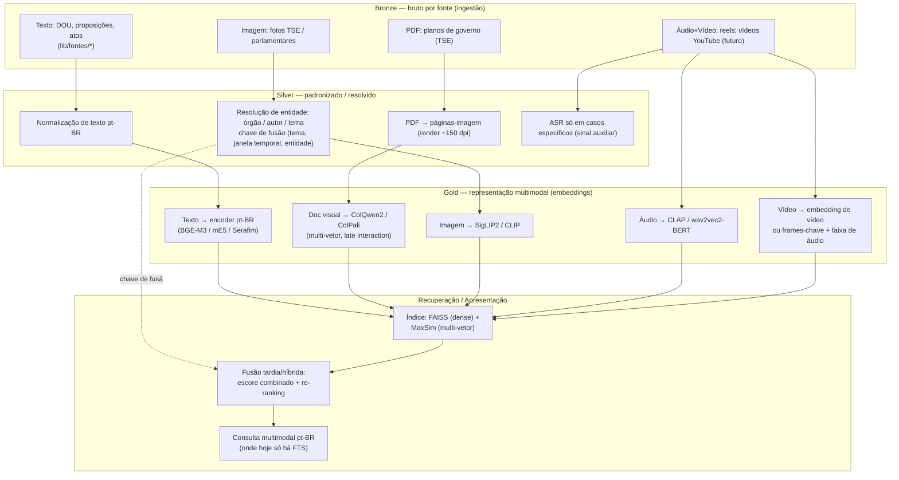

# Arquitetura de Fusão de Dados Não Estruturados de Setores Políticos (GovExe)

> Entregável 1 da Semana 6 — *projeto/visão*, não um sistema implementado.
> Disciplina Residência em IA (BIA/UFG), tema "Fusão de Big Data e RI Multimodal".
> Estudo de caso: **GovExe** (civic tech que traduz dados oficiais do governo brasileiro
> para linguagem simples). Base conceitual: §3.4 e §3.6 do `README.md`.

## 1. Problema e recorte

O GovExe ingere dados de **~15 fontes públicas oficiais** (DOU, Câmara, Senado, TCU, CGU,
TSE, IBGE, BCB, Comprasnet, Datajud/TJs, Transparência) e hoje recupera conteúdo por
**busca textual (FTS do Postgres: `to_tsvector('portuguese', …)`, `pg_trgm`, `unaccent`)**.
Não há embeddings, pgvector nem RAG no projeto — é *greenfield*.

O recorte desta arquitetura é a **fusão para recuperação**: unificar dados **não
estruturados e multimodais** de setores políticos numa camada de representação que
permita recuperar por **significado** e **através de modalidades** — onde o FTS não
alcança (documentos visualmente ricos, imagem, áudio, vídeo).

Duas tradições de "fusão" convergem aqui (ver README §3.4):
- **Fusão entre fontes** (Zheng, 2015): integrar datasets heterogêneos de domínios
  diferentes por significado.
- **Fusão entre modalidades** (Zhao; Zhang; Geng, 2024): combinar modalidades numa
  representação única (deep multimodal fusion), ponte feita por Zheng (2025).

## 2. Modalidades (o que já flui no GovExe + visão futura)

| Modalidade | Origem no GovExe | Status |
|---|---|---|
| Texto (ato oficial) | config `dou` / tabela `atos_dou` (par documento↔simplificação) | coletado |
| Texto (proposição) | `proposicoes_simplificadas` (só link do original) | coletado |
| **Documento visual (PDF)** | `planos_governo` / `pdf_url` (planos de governo TSE) | coletado |
| Imagem | fotos TSE de candidatos (161×225), fotos de parlamentares | coletado |
| Áudio + vídeo | reels narrados (TTS + Remotion) | coletado |
| **Vídeo externo** | captura de vídeos do **YouTube** (sessões, pronunciamentos, comissões) | **visão futura** |

**RI multimodal ≠ só texto/documento.** A visão abrange **captura e recuperação** de
imagens, áudios, documentos e vídeos como modalidades de **primeira classe**. A
**transcrição (ASR, fala→texto)** é **sinal auxiliar para casos específicos**, não a
redução padrão de áudio/vídeo a texto.

## 3. Camadas (padrão medalhão do lakehouse)

A fusão de fontes ocorre na progressão **Bronze → Silver → Gold** (README §3.6;
DATABRICKS/MICROSOFT, 2026), e a **fusão de modalidades** ocorre na camada de
representação (Gold) e no momento da recuperação.

### 3.1 Bronze — ingestão
Reusa os conectores por fonte já existentes no GovExe (`lib/fontes/*.ts`). Dados brutos,
por modalidade, sem transformação semântica. (Fusão *stage-based* de Zheng: integração
no estágio de dados.)

### 3.2 Silver — padronização e resolução de entidades
Normalização de texto pt-BR; **renderização de PDF em páginas-imagem**; resolução de
entidades (órgão emissor, autor, tema/`categoria`) e definição da **chave de fusão entre
fontes** `(tema, janela temporal, entidade)` — é aqui que proposição ↔ ato do DOU ↔ eixo
de plano se ligam (fusão *semantic-meaning-based* de Zheng, 2015). ASR entra só em casos
específicos como sinal textual complementar.

### 3.3 Gold — representação multimodal
Cada modalidade é projetada num espaço de embeddings próprio (ou compartilhado, quando o
modelo é nativamente multimodal). É a **decisão de maior risco** da arquitetura — *qual
encoder recupera melhor* — e exatamente o que o benchmark (Entregáveis 2–3) valida.

### 3.4 Recuperação — fusão tardia/híbrida
Índice **dense (FAISS)** para single-vector e **MaxSim (late interaction)** para
multi-vetor (ColPali/ColQwen2). A fusão na consulta é **tardia/híbrida** (Zhao et al.,
2024): combinar escores por modalidade e re-ranquear, usando a chave de fusão do Silver
para agrupar evidências da mesma entidade/tema entre fontes.

## 4. Mapeamento às taxonomias (síntese)

| Decisão da arquitetura | Taxonomia / base |
|---|---|
| Ligar fontes por tema/entidade (Silver) | Zheng (2015): cross-domain, *semantic-meaning-based* |
| Integração no estágio de ingestão (Bronze) | Zheng (2015): *stage-based* |
| Texto + página-imagem numa representação | Zhao; Zhang; Geng (2024): deep multimodal, *late/hybrid fusion* |
| Ponte entre fusão-de-fontes e fusão-de-modalidades | Zheng (2025, arXiv:2506.03155) |
| Fusão de fontes na progressão Bronze/Silver/Gold | Lakehouse / medalhão (DATABRICKS; MICROSOFT, 2026) |

## 5. O que o benchmark desta semana valida

O benchmark (código em `benchmark/`) exercita a **camada Gold** no caso de **documento
visual** (a 1ª fatia): compara ColQwen2/ColPali (e um slice CLIP/SigLIP2) em **ViDoRe v2**
(validação externa) e num **conjunto pt-BR derivado dos planos** do GovExe. As demais
modalidades (imagem↔texto, áudio, vídeo/YouTube) e o índice de **produção** (pgvector/RAG
no GovExe) ficam como extensão futura — esta semana entrega o **projeto** da arquitetura e
a validação da fatia doc-visual.

## 6. Limites e honestidade metodológica

- Arquitetura é **projeto**; não há índice vetorial em produção no GovExe hoje.
- O conjunto pt-BR é **exploratório** (27 planos, 5 UFs + BR; queries derivadas de alvos
  gerados por IA — viés do `gpt-4o`). Ameaça à validade documentada no `dataset/README.md`.
- RI e Big Data seguem como **trilhas separadas** nesta semana; a arquitetura é onde elas
  se encontram conceitualmente, não um sistema único já implementado.

## Referências
Ver `README.md` §3.3–3.6 e `docs/fontes-recentes-semana6.md`. Âncoras: Zheng (2015);
Zhao, Zhang e Geng (2024, ACM CSUR); Zheng (2025, arXiv:2506.03155); ColPali (ICLR 2025);
ViDoRe v2 (arXiv:2505.17166); DATABRICKS/MICROSOFT/DREMIO/IBM/AWS (2024–2026).
