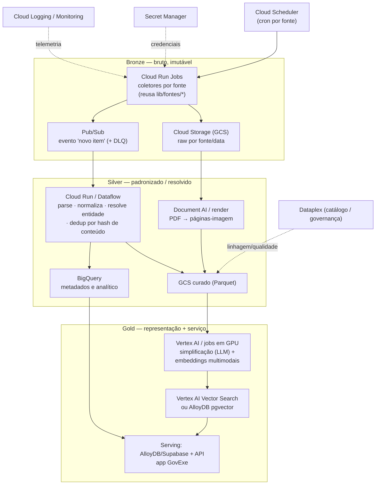

# Arquitetura de Coleta de Dados do GovExe em GCP

> Companheiro de `fusao/arquitetura.md`. Enquanto aquele documento descreve a **fusão
> para recuperação** (Bronze→Silver→Gold), este detalha a **camada de coleta/ingestão**
> das ~15 fontes oficiais, desenhada com serviços da **Google Cloud (GCP)**.
> Projeto/visão da Semana 6 — não implementado em produção.

## 1. Objetivo e recorte

O GovExe hoje coleta de ~15 fontes públicas (DOU, Câmara, Senado, TCU, CGU, TSE, IBGE,
BCB, Comprasnet, Datajud/TJs, Portal da Transparência, ANVISA) com conectores em
`lib/fontes/*.ts`, roda em Vercel + Supabase e simplifica em *cron jobs*. O objetivo aqui
é **redesenhar a coleta em GCP** de forma escalável, confiável e **idempotente** (sem
duplicatas), alimentando a arquitetura de fusão e a futura busca multimodal.

Princípios herdados do projeto: **IA fora do caminho de request** (coleta e processamento
assíncronos), **o resumo é porta para a fonte** (rastreabilidade: cada item guarda a URL
oficial), e **só fontes públicas oficiais**.

## 2. Tipos de fonte e padrão de coleta

| Tipo | Fontes | Padrão de coleta |
|---|---|---|
| **API REST/JSON** | Câmara e Senado (Dados Abertos), IBGE, BCB, Portal da Transparência, Comprasnet, TSE (dados abertos), Datajud/CNJ | *pull* paginado por API; incremental por data/`id` |
| **Portal / boletim** | DOU (Imprensa Nacional), TCU, CGU | download estruturado quando há API; *scraping leve* respeitando `robots`/termos |
| **Arquivos** | PDFs de planos de governo (TSE/Storage), fotos de candidatos (TSE 161×225) | download por URL estável; render de PDF → página-imagem |
| **Mídia (futuro)** | Vídeos do YouTube (sessões, pronunciamentos, comissões), áudio | captura por URL; transcodificação; ASR **só em casos específicos** |

## 3. Arquitetura (GCP, alinhada ao medalhão)

## 4. Componentes GCP por camada

| Camada | Serviço GCP | Função |
|---|---|---|
| Agendamento | **Cloud Scheduler** | dispara cada coletor no seu cron (ex.: DOU diário, IBGE mensal) |
| Orquestração | **Cloud Workflows** (ou **Cloud Composer/Airflow** se os DAGs crescerem) | encadeia coleta → normalização → representação; *retries* e dependências |
| Coleta | **Cloud Run Jobs** (contêiner por fonte; *scale-to-zero*) | executa os conectores `lib/fontes/*`; sem servidor ocioso |
| Landing bruto | **Cloud Storage** (bucket Bronze, *object versioning*) | payloads crus (JSON, PDF, imagem, vídeo) particionados por `fonte/dt` |
| Mensageria | **Pub/Sub** (+ *dead-letter topic*) | desacopla coleta de processamento; *fan-out* e reprocesso |
| Transformação | **Dataflow** (Apache Beam) ou **Cloud Run** | parse, padronização, resolução de entidade, dedup |
| Documento | **Document AI** (OCR/layout) e/ou render próprio | PDF → texto estruturado e/ou páginas-imagem |
| Warehouse | **BigQuery** | metadados, séries, análises; fonte do analítico |
| Representação | **Vertex AI** (endpoints/batch) ou **jobs GPU (GKE/Batch)** | simplificação por LLM + embeddings (ColEmbed/Qwen3-VL-Embedding) |
| Índice vetorial | **Vertex AI Vector Search** ou **AlloyDB pgvector** | busca semântica/multimodal |
| Serving | **AlloyDB for PostgreSQL** (ou Supabase atual) | banco do app GovExe + pgvector |
| Segredos | **Secret Manager** | chaves de API das fontes e de LLM |
| Observabilidade | **Cloud Logging/Monitoring**, alertas | saúde dos coletores, latência, falhas, DLQ |
| Governança | **Dataplex** | catálogo, linhagem e qualidade sobre o lake |

### 4.1 Etapa de embedding (Gold) — detalhe da Semana 7

A representação do Gold usa o **modelo unificado Qwen3-VL-Embedding** (2B na primeira
fatia; 8B ou WeMM-9B como teto), rodando em **VM GPU efêmera** (L4, `g2-standard-4`,
**liga/desliga**) — custo proporcional ao lote, sem servidor ocioso. Os vetores saem
**L2-normalizados** (MRL/Matryoshka para truncar a dimensão e baratear o índice) e vão
para **Cloud SQL (PostgreSQL) + pgvector**, com **upsert idempotente por hash / id de
página** (reprocessar não duplica). A consulta é por cosine (`<=>` do pgvector). **Áudio
não entra no unificado** → **ASR→texto (pointer vector)**.

A alternativa de **ensemble de especialistas + pointer vector** e o **protocolo de A/B**
(unificado × ensemble) estão em `fusao/multimodal.md`. A implementação da fatia vertical
(coletor → GCS → embedding → pgvector → consulta) está em `gcp/slice/` (ver
`README-slice.md`): credenciais via **Secret Manager**, VM efêmera e **teardown** ao fim.

## 5. Idempotência, incremental e reprocesso

- **Chave de deduplicação**: `hash(conteúdo)` + chave natural da fonte (ex.: `(proposicao_id, casa)`, `url_oficial`, `tse_sequencial`). Grava-se só o que é novo.
- **Incremental**: cada coletor guarda um *watermark* (último `id`/data processado) em GCS/BigQuery; a próxima execução busca só o delta.
- **GCS como verdade do bruto**: *object versioning* preserva o original; reprocessar = reemitir eventos Pub/Sub sobre os objetos Bronze, sem recoletar.
- **Entrega ao menos uma vez** do Pub/Sub ⇒ consumidores idempotentes (chave de deduplicação + *upsert*).
- **DLQ** no Pub/Sub para itens que falham; reprocesso controlado.

## 6. Mídia (extensão futura)

- **Vídeo (YouTube)**: captura por URL → **GCS**; **Transcoder API** para normalizar; extração de *frames-chave*; embedding de vídeo.
- **Áudio**: **Speech-to-Text** apenas em **casos específicos** (ASR como sinal auxiliar, não redução padrão — coerente com `fusao/arquitetura.md`).
- Observar a Resolução TSE 23.732/2024: nada de síntese de imagem/áudio de candidatos.

## 7. Mapeamento ao medalhão (consistência com a fusão)

- **Bronze** = GCS raw (imutável, por fonte/data) → fusão *stage-based* (Zheng, 2015).
- **Silver** = normalização + resolução de entidade + dedup → chave de fusão
  `(tema, janela temporal, entidade)` (fusão *semantic-meaning-based*).
- **Gold** = embeddings multimodais + índice vetorial → fusão de modalidades
  (Zhao et al., 2024) e serving da busca.

## 8. Custo e migração

- **Scale-to-zero** (Cloud Run Jobs, Pub/Sub, BigQuery on-demand) mantém o custo
  proporcional ao volume — adequado a um projeto de civic-tech.
- **Migração suave**: manter Supabase como *serving* no início e mover apenas
  **coleta + processamento pesado** para GCP; evoluir para AlloyDB/Vertex se necessário.
- **GPU**: a representação (embeddings) pode rodar em **jobs** (GKE/Batch) sob demanda,
  ou em Vertex AI — os mesmos modelos avaliados no benchmark (ColEmbed/Qwen3-VL-Embedding).

## Referências
Ver `fusao/arquitetura.md` (taxonomias de fusão) e `README.md` §3.6 (Fusão × DW × Lake ×
Lakehouse). Serviços GCP: Cloud Scheduler, Cloud Run, Pub/Sub, Cloud Storage, Dataflow,
Document AI, BigQuery, Vertex AI (Vector Search), AlloyDB, Secret Manager, Dataplex.
